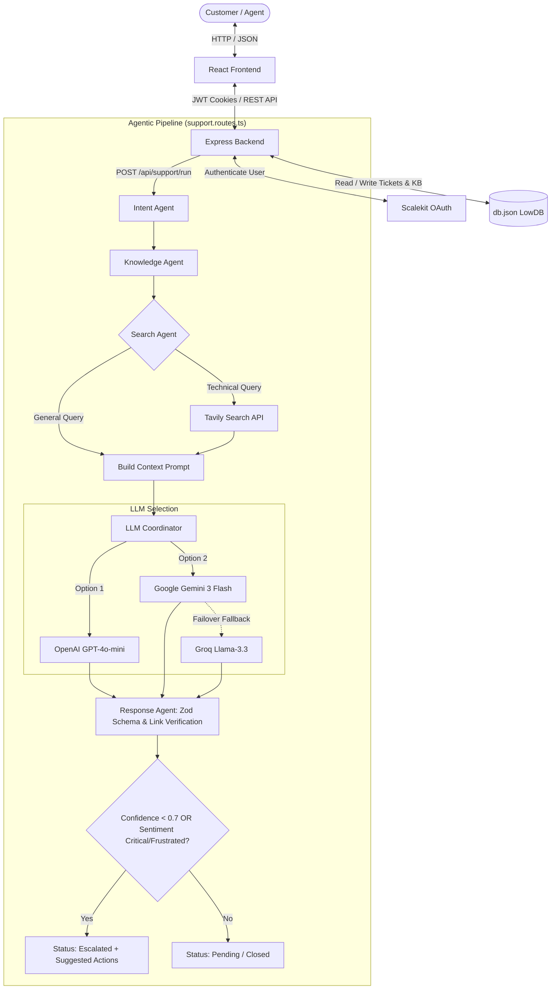

# 🧠 Agentic Support Desk — Full-Stack AI Application

A premium, production-ready full-stack **Support Desk Agent** that accepts customer tickets, performs multi-agent workflows, grounds answers with web search or internal knowledge bases, and generates structured AI replies with automated escalation workflows.

This project demonstrates modern AI backend design, security compliance, session handling, and advanced agentic orchestration.

---


## ✨ Features

*   **🔒 Secure Session Authentication**: Cookie-based authentication using `httpOnly` JWT cookies preventing XSS token theft, integrated with [Scalekit OAuth](https://www.scalekit.com/) or simulated via a dev-only E2E authentication mode.
*   **🤖 Multi-Agent Orchestration**: Powered by [LangGraph](https://www.langchain.com/langgraph) and [LangChain](https://www.langchain.com/), coordinating specialized sub-agents:
    *   **Intent Agent**: Analyzes customer ticket topics.
    *   **Knowledge Agent**: Performs fuzzy keyword matches against the internal Knowledge Base.
    *   **Search Agent**: Determines if a technical query requires external information and triggers a [Tavily Search](https://tavily.com/) lookup.
    *   **Response Agent**: Sentiment classification (positive, neutral, frustrated, critical) and response drafting with confidence rating.
*   **🛡️ Strict Validation & Guardrails**: Full JSON output schema validation using [Zod](https://zod.dev/) schemas. Validates grounding URLs returned by the model to prevent hallucinated citations.
*   **🔌 LLM Provider Agility**: Seamless switching between OpenAI (GPT-4o-mini) and Google Gemini (Gemini 3 Flash Preview) with an automatic failover fallback to Groq (Llama-3.3-70b-versatile).
*   **📈 Real-Time Support Analytics**: Live dashboard showcasing support ticket metrics, sentiment distributions, average confidence scores, and agent workload data.
*   **⚠️ Auto-Escalation Engine**: Automatically flags tickets for human engineers with recommended support actions and drafted responses when confidence drops below `0.7` or sentiment is classified as `critical`/`frustrated`.

---

## 🏗️ Architecture

The app uses a decoupled Client-Server architecture. The server acts as an API gateway, session controller, and LLM coordinator, while the client handles routes, analytics displays, and support workflow interaction.



---

## 🧰 Tech Stack

| Component | Technology / Library | Description |
| :--- | :--- | :--- |
| **Frontend** | React, TypeScript, Vite | Fast, responsive single-page web app. |
| | React Router v6 | Declarative layout, routing, and route protections. |
| | Tailwind CSS | Utility-first clean CSS styling with customizable tokens. |
| | Recharts | Interactive dashboard visualizations (analytics). |
| **Backend** | Node.js, Express, TypeScript | Highly extensible server API with structured routes. |
| | LangChain, `@langchain/langgraph` | Workflow state machines, agent frameworks, and LLM calls. |
| | Zod | Runtime schema verification and strict type enforcement. |
| | JSON Web Tokens (JWT) | Cookie-based session validation. |
| | Lowdb / File-based JSON | Lightweight, mockable schema-driven JSON database. |

---

## 📁 Key File Map

Feel free to browse the main components of the codebase:

*   **Server Backend**:
    *   [index.ts](file:///c:/Users/aggis/Desktop/fullstack_ai_Supportdesk_Agent_with_longchain/server/src/index.ts) — Express entry point and server configuration.
    *   [support.routes.ts](file:///c:/Users/aggis/Desktop/fullstack_ai_Supportdesk_Agent_with_longchain/server/src/support/support.routes.ts) — The heart of the multi-agent AI execution, fallback flows, and database updates.
    *   [support.schema.ts](file:///c:/Users/aggis/Desktop/fullstack_ai_Supportdesk_Agent_with_longchain/server/src/support/support.schema.ts) — Zod schemas validating API requests and structured AI agent responses.
    *   [db.ts](file:///c:/Users/aggis/Desktop/fullstack_ai_Supportdesk_Agent_with_longchain/server/src/support/db.ts) — Database helper layer managing articles, tickets, messages, and analytics logs.
    *   [auth.routes.ts](file:///c:/Users/aggis/Desktop/fullstack_ai_Supportdesk_Agent_with_longchain/server/src/auth/auth.routes.ts) — OAuth registration endpoints and callback handlers.
    *   [e2e.routes.ts](file:///c:/Users/aggis/Desktop/fullstack_ai_Supportdesk_Agent_with_longchain/server/src/auth/e2e.routes.ts) — Dev-only authentication routes allowing simulated user registration for tests.
*   **Client Frontend**:
    *   [App.tsx](file:///c:/Users/aggis/Desktop/fullstack_ai_Supportdesk_Agent_with_longchain/client/src/App.tsx) — Front-end routing structure and private/public layout definitions.
    *   [support.tsx](file:///c:/Users/aggis/Desktop/fullstack_ai_Supportdesk_Agent_with_longchain/client/src/pages/support.tsx) — Main ticket management platform, chat logs, and manual ticketing.
    *   [landing.tsx](file:///c:/Users/aggis/Desktop/fullstack_ai_Supportdesk_Agent_with_longchain/client/src/pages/landing.tsx) — Interactive live dashboard showing support analytics, SLA trends, and agent queues.

---

## ⚙️ Environment Variables

### Backend Configuration

Create a `.env` file under the `server` directory:

```env
PORT=5000
NODE_ENV=development
BACKEND_URL=http://localhost:5000
FRONTEND_URL=http://localhost:5173

# Authentication Sessions
SESSION_COOKIE_NAME=session
SESSION_JWT_SECRET=your_jwt_signing_secret_here

# LLM Providers API Keys
OPENAI_API_KEY=sk-proj-your-openai-key
GEMINI_API_KEY=AIzaSy-your-gemini-key
TAVILY_API_KEY=tvly-your-tavily-search-key
GROQ_API_KEY=gsk_your-fallback-groq-key

# Scalekit OAuth Integration
SCALEKIT_ENVIRONMENT_URL=https://your-scalekit-domain.scalekit.com
SCALEKIT_CLIENT_ID=your_client_id
SCALEKIT_CLIENT_SECRET=your_client_secret

# Dev/Testing Configuration
E2E_TEST_MODE=true
```

### Frontend Configuration

Create a `.env` file under the `client` directory:

```env
VITE_BACKEND_URL=http://localhost:5000
```

---

## 🚀 Running Locally

Ensure you have [Node.js](https://nodejs.org/) installed (v18+ recommended).

### 1. Initialize and Start the Backend Server

```bash
# Navigate to server folder
cd server

# Install dependencies
npm install

# Start development server
npm run dev
```
The server will boot on [http://localhost:5000](http://localhost:5000).

### 2. Initialize and Start the React App

```bash
# Open a new terminal and navigate to client folder
cd client

# Install dependencies
npm install

# Start Vite dev server
npm run dev
```
The frontend will start on [http://localhost:5173](http://localhost:5173).

---

## 📡 API Endpoints Reference

### Public Endpoints
*   `GET /status` — Returns server health status. `{ "ok": true }`
*   `GET /auth/login` — Redirects user to Scalekit OAuth authorization URL.
*   `GET /auth/callback` — Handles post-auth tokens, sets session cookies, and redirects back to the dashboard.

### Dev/Testing Endpoints
*   `POST /auth/e2e/login` — Accessible only when `E2E_TEST_MODE=true` and `NODE_ENV=development`. Expects a JSON body describing the test user and issues a signed session cookie.

### Protected Endpoints (Requires Valid Session Cookie)
*   `GET /auth/me` — Returns the details of the currently authenticated session user.
*   `POST /auth/logout` — Destroys the cookie session.
*   `GET /api/support/analytics` — Fetches aggregate support desk reports (SLA, ticket status distributions, agent performance).
*   `GET /api/support/tickets` — Lists all tickets in the system.
*   `POST /api/support/tickets` — Creates a new manual ticket.
*   `GET /api/support/tickets/:id` — Details of a specific ticket, including dialogue history.
*   `PATCH /api/support/tickets/:id` — Modifies status (e.g. changing status to `escalated`, `pending`, `closed`).
*   `GET /api/support/kb` — Lists all articles from the Internal Knowledge Base.
*   `POST /api/support/kb` — Adds a new article to the Knowledge Base.
*   `DELETE /api/support/kb/:id` — Deletes an article from the Knowledge Base.
*   `POST /api/support/run` — Executes the LangGraph agent pipeline. Validates prompt text, conducts optional search, prompts the selected LLM, runs fallback if needed, filters bad citations, handles database updates, and manages escalation checks.

---

## 🧪 Testing

The codebase includes standard end-to-end authentication tests inside the `testsprite_tests` directory.

To run these tests, refer to the [TESTING.md](file:///c:/Users/aggis/Desktop/fullstack_ai_Supportdesk_Agent_with_longchain/TESTING.md) guide.

Key test coverage includes:
1. Public API accessibility verification.
2. 401 Unauthorized exceptions on guarded routes.
3. Cookie verification and session generation.
4. Token parsing validation.

---

## 🎯 Design Decisions

1.  **Security Gating**: Using `httpOnly` cookie flags prevents browser-side Javascript from reading the JWT token, eliminating common XSS vectors.
2.  **Deterministic AI Boundaries**: Rather than returning free-form text, the LLM output is structurally validated using a Zod schema `DraftSchema` definition. This ensures that properties like `confidenceScore` and `sentiment` are consistently typed.
3.  **Search Filtering & Validation**: Any citations/links in the output are validated against the actual URLs fetched by the Search Agent. Hallucinated links generated by the LLM are stripped out automatically.
4.  **Provider Failover**: Production agents cannot afford timeouts. If Gemini API requests fail during agent runs, the system automatically redirects instructions to Groq/Llama configurations ensuring high uptime.
